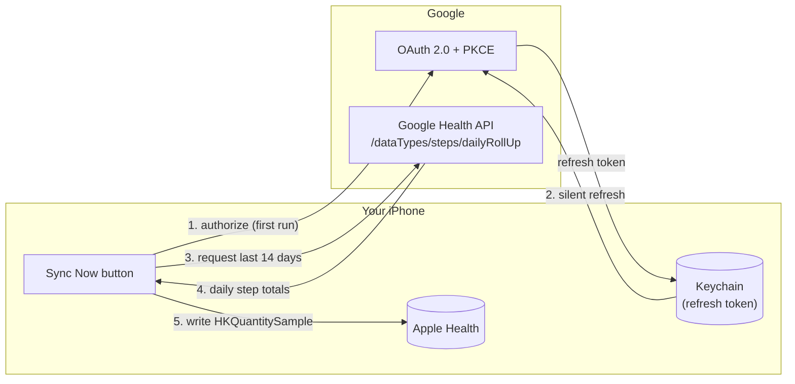

# StepsBridge 👟➡️🍎

**Sync your daily step count from Google Health to Apple Health — automatically, privately, on your own phone.**

<p align="left">
  
  
  
  
</p>

Google shut off the old **Fitbit Web API** on Nov 2, 2026, which broke the "Fitness Data Sync"
app this project replaces. StepsBridge talks to Google's new **Google Health API** instead,
and writes the results straight into Apple Health with a single tap.

> **Heads up:** this repository contains source code only. It was written in a Linux cloud
> container with no Xcode, so it has never been compiled or run. You need a Mac with Xcode
> to build it — see [Build it](#4-build-it-on-a-mac).

---

## Contents

- [How it works](#how-it-works)
- [Features](#features)
- [Setup](#setup)
  1. [Google Cloud setup](#1-google-cloud-setup-one-time-~10-min)
  2. [Link your Google Health profile](#2-link-your-google-health-profile)
  3. [Configure the app](#3-configure-the-app)
  4. [Build it on a Mac](#4-build-it-on-a-mac)
- [Project layout](#project-layout)
- [Limitations](#limitations)
- [Troubleshooting](#troubleshooting)

---

## How it works

Tapping **Sync Now** runs a short pipeline: authenticate with Google (first time only, then
silently refresh), pull the last two weeks of step totals, and write them into Apple Health
as one sample per day — re-syncing a day overwrites it instead of creating a duplicate.



## Features

| | |
|---|---|
| 🔐 **Your data stays yours** | OAuth tokens live in iOS Keychain; nothing passes through a third-party server. |
| 🔁 **Safe to re-run** | Pulls a 14-day trailing window and tags each sample, so missing a day — or tapping sync twice — never duplicates data. |
| 👆 **Manual, on purpose** | One **Sync Now** button, matching how you already check the Google Health app once a day. See [why there's no background sync](#limitations). |
| 🧩 **Small, readable codebase** | Four focused Swift files, no third-party dependencies, generated with [XcodeGen](https://github.com/yonaskolb/XcodeGen). |

## Setup

### 1. Google Cloud setup (one-time, ~10 min)

<details>
<summary><b>Click to expand the Google Cloud Console steps</b></summary>

1. Go to the [Google Cloud Console](https://console.cloud.google.com/) and create a new
   project (e.g. "StepsBridge").
2. Enable the **Google Health API** for that project:
   [APIs & Services → Library](https://console.cloud.google.com/apis/library) → search
   "Google Health API" → **Enable**.
3. Configure the **OAuth consent screen** (APIs & Services → OAuth consent screen):
   - User type: **External**.
   - Leave **Publishing status: Testing**. Do *not* publish/verify the app — that triggers
     Google's restricted-scope security review, which is overkill for personal use.
   - Under **Audience → Test users**, add your own Google account email.
   - Under **Data access** → "Add or remove scopes" → search "Google Health API" → add:
     `.../auth/googlehealth.activity_and_fitness.readonly`.
4. Create the **OAuth client ID** (APIs & Services → Credentials → Create Credentials →
   OAuth client ID):
   - Google's Health API setup guide says to choose **Web application** (it issues a
     client secret, needed for the refresh-token flow this app uses).
   - Authorized redirect URI: `com.yanivbahalul.stepsbridge:/oauth2redirect`
   - If the Cloud Console rejects a non-`https` redirect URI for a Web application client,
     switch the client type to **iOS** or **Desktop app** instead — those accept custom
     URL schemes. The app's code doesn't change either way; only this console step does.
5. Copy the **Client ID** and **Client secret** — you'll need them in step 3.

</details>

### 2. Link your Google Health profile

Install the **Google Health** app (App Store / Play Store) on your phone and sign in with
the same Google account *before* connecting from StepsBridge. The OAuth consent screen
can't detect this for you, so skipping it is a common cause of an empty first sync.

### 3. Configure the app

```bash
cp Sources/Config/Secrets.example.plist Sources/Config/Secrets.plist
```

Edit `Sources/Config/Secrets.plist`:

| Key | Value |
|---|---|
| `GoogleOAuthClientID` | the Client ID from step 1 |
| `GoogleOAuthClientSecret` | the Client secret from step 1 |
| `GoogleOAuthRedirectURI` | leave as `com.yanivbahalul.stepsbridge:/oauth2redirect` unless you changed the bundle ID in `project.yml`, in which case match it there too |

`Secrets.plist` is gitignored — it's never committed.

### 4. Build it on a Mac

Requires Xcode and [XcodeGen](https://github.com/yonaskolb/XcodeGen) (`brew install xcodegen`):

```bash
xcodegen generate
open StepsBridge.xcodeproj
```

In Xcode:

1. Select your Apple ID team under **Signing & Capabilities** — HealthKit requires a real
   device, it doesn't work in the Simulator.
2. Build and run on your iPhone.
3. Tap **Connect Google Health**, sign in, grant the steps permission.
4. Tap **Sync Now**. Open **Apple Health → Browse → Activity → Steps** to confirm the data
   landed there.

## Project layout

```
Sources/
├── App/            StepsBridgeApp.swift, ContentView.swift — entry point & UI
├── Auth/           GoogleAuthManager.swift — OAuth 2.0 + PKCE, token refresh
│                   KeychainStore.swift — refresh token storage
├── Health/         GoogleHealthClient.swift — Google Health API calls
│                   HealthKitWriter.swift — writes HKQuantitySample into Apple Health
├── Sync/           SyncCoordinator.swift — orchestrates auth + fetch + write
└── Config/         AppConfig.swift, Secrets.plist (gitignored)
```

| File | Responsibility |
|---|---|
| `Auth/GoogleAuthManager.swift` | OAuth 2.0 authorization-code + PKCE flow via `ASWebAuthenticationSession`; token exchange/refresh against `oauth2.googleapis.com/token`; refresh token stored in Keychain. |
| `Health/GoogleHealthClient.swift` | Calls `POST https://health.googleapis.com/v4/users/me/dataTypes/steps/dataPoints:dailyRollUp` for the trailing 14 days. |
| `Health/HealthKitWriter.swift` | Writes one `HKQuantitySample` per day into Apple Health, tagged with metadata so re-syncing overwrites instead of duplicating. |
| `Sync/SyncCoordinator.swift` | Orchestrates the two above when you tap **Sync Now**. |

## Limitations

- **Weekly re-authentication.** While the OAuth client stays in Testing mode (the tradeoff
  for skipping Google's app review), refresh tokens expire after ~7 days — you'll need to
  tap **Connect Google Health** again roughly once a week.
- **No background sync.** iOS's HealthKit background delivery is for *reading*, not for
  writing from a third-party cloud source on a schedule. Manual **Sync Now** is the
  pragmatic choice given you already check in once a day.
- **A newly launched API.** If Google changes the Google Health API response shape, check
  the [endpoints reference](https://developers.google.com/health/endpoints) and update
  `GoogleHealthClient.swift`.

## Troubleshooting

<details>
<summary><b>First sync pulls no data</b></summary>

Make sure you signed into the **Google Health** app with the same account before
connecting — see [step 2](#2-link-your-google-health-profile).
</details>

<details>
<summary><b>"Connect Google Health" fails or loops back immediately</b></summary>

Double-check the redirect URI matches exactly between `Secrets.plist`, `project.yml`
(`GOOGLE_OAUTH_REDIRECT_SCHEME`), and the Authorized redirect URI in Google Cloud Console.
</details>

<details>
<summary><b>HealthKit permission prompt never appears / app crashes on launch</b></summary>

HealthKit requires a real device — it isn't available in the iOS Simulator. Confirm you're
running on a physical iPhone with your Apple ID team selected in Signing & Capabilities.
</details>

<details>
<summary><b>I get asked to sign in to Google every few days</b></summary>

Expected while the OAuth client is in Testing mode — see
[Limitations](#limitations). Moving out of Testing mode requires Google's app
verification process, which isn't worth it for a single-user app.
</details>
