<div align="center">

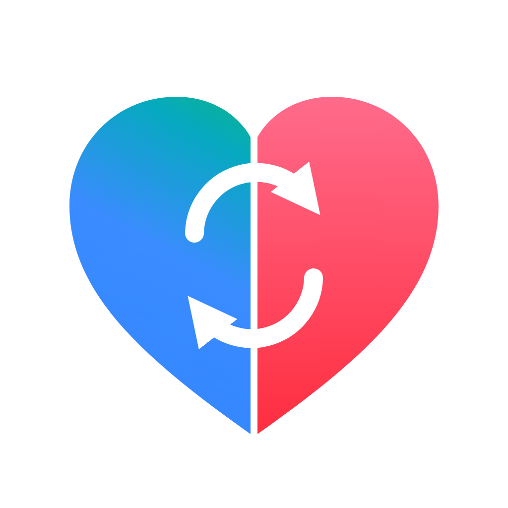

# HealthBridge

**Your fitness band's data in Apple Health again, plus a food diary that tracks your weight loss.**

<a href="https://github.com/yanivbahalul/fitness-google-sync/actions/workflows/build.yml"></a>


<a href="https://developers.google.com/health"></a>
<a href="https://docs.anthropic.com"></a>

<a href="#privacy"></a>
<a href="https://github.com/yanivbahalul/fitness-google-sync/commits/main"></a>


[Features](#features) · [How it works](#how-it-works) · [Setup](#setup) · [Privacy](#privacy) · [Troubleshooting](#troubleshooting)

</div>

<table>
  <tr>
    <td align="center" valign="top" width="25%">
      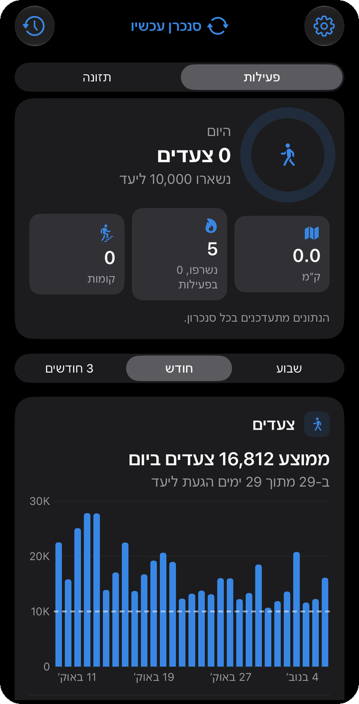<br>
      <b>Activity</b><br>
      <sub>Today's steps against the goal, distance, total calories burned and floors, then trends for a week, month or 3 months.</sub>
    </td>
    <td align="center" valign="top" width="25%">
      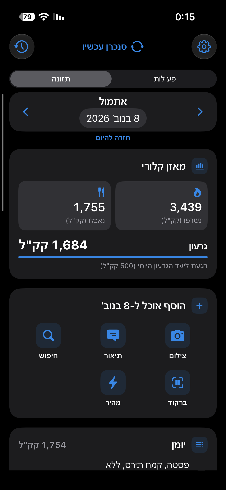<br>
      <b>Calorie balance</b><br>
      <sub>Burned (from Google) vs eaten for any day, the deficit and the daily goal, and five ways to add food.</sub>
    </td>
    <td align="center" valign="top" width="25%">
      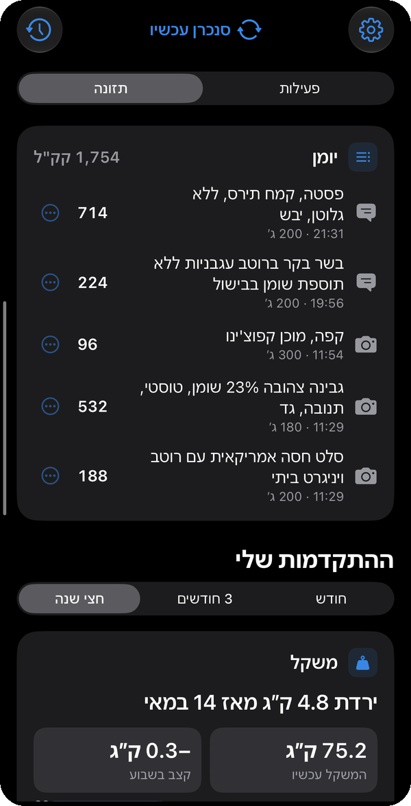<br>
      <b>Food diary</b><br>
      <sub>Everything logged that day, with how it was added (photo, text, search). Tap ⋯ to edit or delete.</sub>
    </td>
    <td align="center" valign="top" width="25%">
      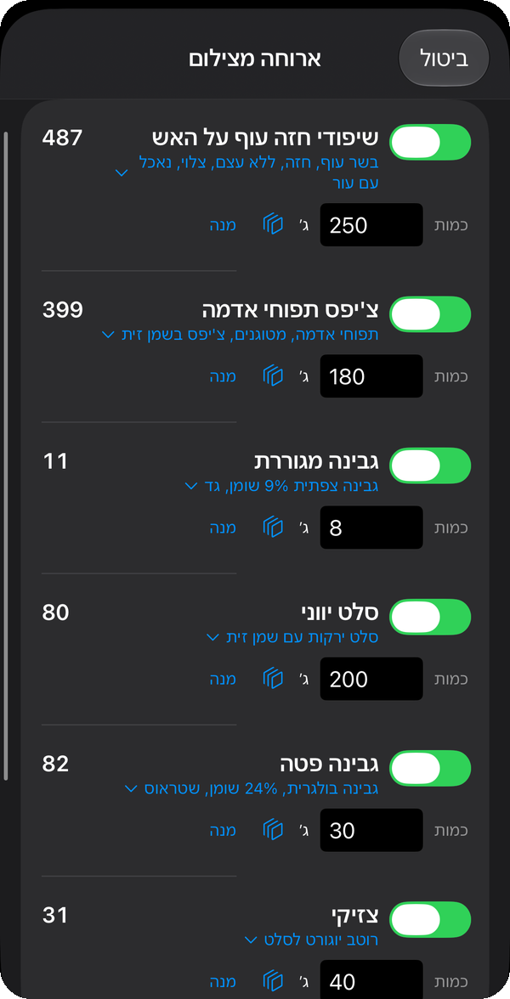<br>
      <b>Meal from a photo</b><br>
      <sub>Claude identifies the foods and grams; you fix amounts or switch items off before saving.</sub>
    </td>
  </tr>
  <tr>
    <td align="center" valign="top" width="25%">
      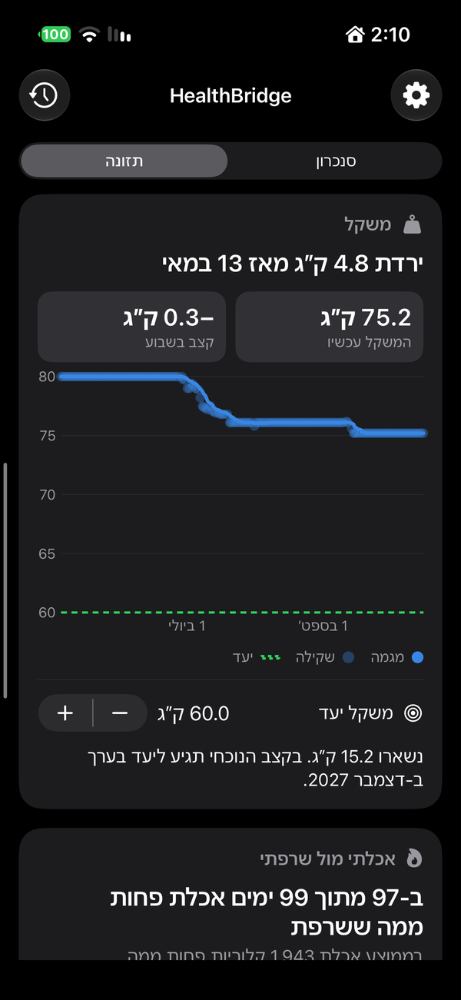<br>
      <b>Weight progress</b><br>
      <sub>Daily weigh-ins and the 7-day trend, weekly pace, a weight goal and when you'll reach it.</sub>
    </td>
    <td align="center" valign="top" width="25%">
      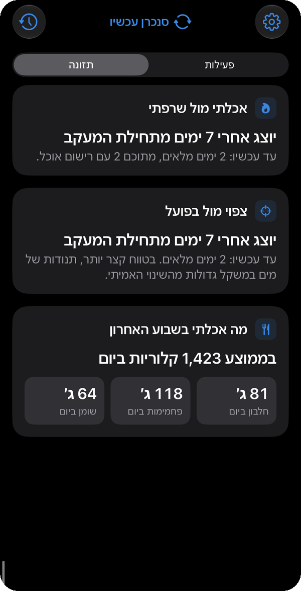<br>
      <b>Balance and macros</b><br>
      <sub>Eaten vs burned and expected vs actual appear after 7 days of tracking; below, last week's averages.</sub>
    </td>
    <td align="center" valign="top" width="25%">
      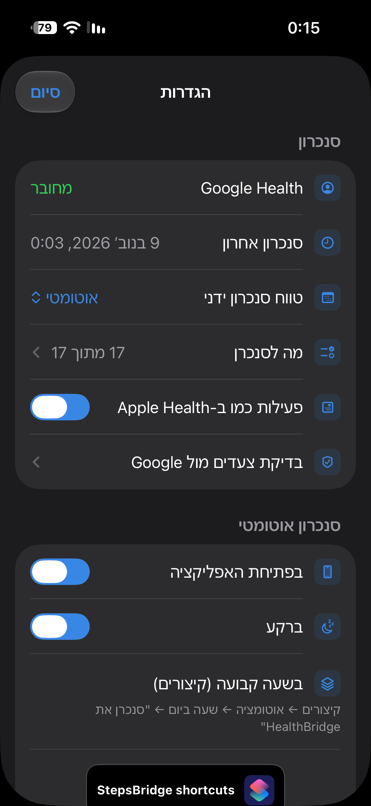<br>
      <b>Settings</b><br>
      <sub>Connection, what to sync, Apple Health display, automatic sync, nutrition, meal analysis and notifications.</sub>
    </td>
    <td align="center" valign="top" width="25%">
      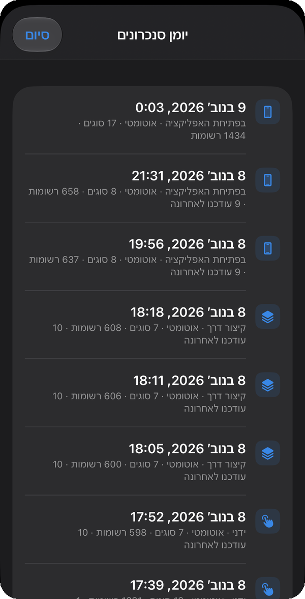<br>
      <b>Sync log</b><br>
      <sub>Every sync with its trigger (app open, Shortcut, manual), types, records and any errors.</sub>
    </td>
  </tr>
</table>

## Why

Google shut off the old **Fitbit Web API** on November 2, 2026, which broke the apps that
copied band data into Apple Health. HealthBridge uses Google's new
**[Google Health API](https://developers.google.com/health/about)** instead, writes 17 kinds
of data into Apple Health, and adds a nutrition screen for logging food and following
weight loss over time. It runs entirely on the phone, with no server.

> The app is called **HealthBridge**. The Xcode project, target and bundle ID keep the
> original `StepsBridge` name on purpose: the Google OAuth client and the data already in
> Apple Health are tied to the bundle ID `com.yanivbahalul.stepsbridge`.

---

## Contents

- [Features](#features)
- [How it works](#how-it-works)
- [Setup](#setup)
- [Everyday use](#everyday-use)
- [Project layout](#project-layout)
- [Privacy](#privacy)
- [Limitations](#limitations)
- [Troubleshooting](#troubleshooting)
- [Data sources](#data-sources)

---

## Features

The app has two pages, **Activity** and **Nutrition** (swipe or use the switcher), with a
compact **Sync now** button in the top bar and everything else in **Settings**.

### Sync

| | |
|---|---|
| **17 data types** | Steps, distance, active energy, floors, workouts, VO2 max, heart rate, resting heart rate, HRV, blood oxygen, respiratory rate, sleep with stages, weight, body fat, height, water, dietary energy. Each can be switched on or off in *Settings → What to sync*. |
| **Steps match Google exactly** | Daily step totals come from Google's own daily roll-up (the number the Google Health app shows); per-minute values (as Google records them) spread that total across the day, so Apple Health shows the same timeline. *Settings → Steps check* compares the last 7 days side by side. |
| **No duplicates** | Every sync replaces only what the sync itself wrote in its window. Food you log and weights you enter are never touched. |
| **Automatic** | Syncs when the app opens (at most every 5 min); in the background when Apple Health receives new steps from the iPhone (at most hourly, no server needed) and on iOS background refresh; and has a *Sync HealthBridge* Shortcuts action. Catches up per type after missed days (up to 14). |
| **History restore** | *Settings → Restore history* re-syncs a week, a month, 3 months, a year, from a chosen date, or everything since the band's first day. Separate from the sync button, which always does the daily sync. |
| **Light on requests** | Steps, distance, calories and heart rate are fetched every sync; sleep, weight, body and daily metrics every 4 hours, workouts hourly (about half the API calls). A Shortcut or background run within 5 minutes of another sync is skipped. |
| **History and notifications** | A sync log with trigger, types, records and errors. Notifications when an automatic sync fails or needs a reconnect, and the day before the free-signing build expires. |

### Activity page

| | |
|---|---|
| **Today** | Steps with a goal ring, distance, floors, and total calories burned (as Google shows it) with active calories underneath. A line shows how fresh Google's data is ("band data until 17:40"). |
| **Trends** | Steps per day against your goal, sleep per night, resting heart rate and VO2 max, for a week, a month or 3 months. |
| **Same numbers as Apple Health** | By default the page shows Apple Health's merged totals (all sources, de-duplicated by the Health app's source priority). Turn off *Settings → Activity like Apple Health* to see only the band's data. Sleep is always the band's only, so a night is never counted twice. |

### Nutrition screen

| | |
|---|---|
| **Meal from a photo** | Claude (Anthropic) identifies the foods and estimates grams; calories come from the Israeli **Tzameret** database when a match is found. Review and fix before saving. |
| **Meal from text** | "2 slices of whole-wheat bread with hummus and a boiled egg". |
| **Hebrew search** | ~4,600 foods from the Ministry of Health database, offline, with household portions (unit, cup, tablespoon…). |
| **Barcode** | Packaged foods via Open Food Facts. |
| **Quick entry** | Just a calorie number, also by Siri: *"Add calories in HealthBridge"*. |
| **Any past day** | Browse, add or delete food for earlier days (never future ones). |
| **Calorie balance** | Burned (Google total calories, incl. resting) vs eaten, with a daily deficit goal. Food other apps write to Apple Health is counted too. |
| **Tracking start** | Food is counted from a start date you choose (*Settings → Nutrition*). From then on, a day with nothing logged counts as balanced (deficit 0), not as a day of fasting. |
| **Progress** | Weight trend with goal projection, eaten-vs-burned per day, expected vs actual weight change, weekly macro averages. The comparison charts appear after 7 full days of tracking. |

Everything logged is also written to Apple Health (energy, protein, carbs, fat).

## How it works

Two independent flows, both running only on the iPhone (there is no server).

**1. Sync: band → Google → HealthBridge → Apple Health**

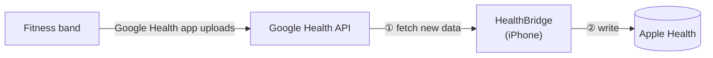

You sign in to Google once; the sign-in token is kept in the iPhone Keychain and refreshed
automatically.

**2. Food: what you ate → calories → Apple Health**

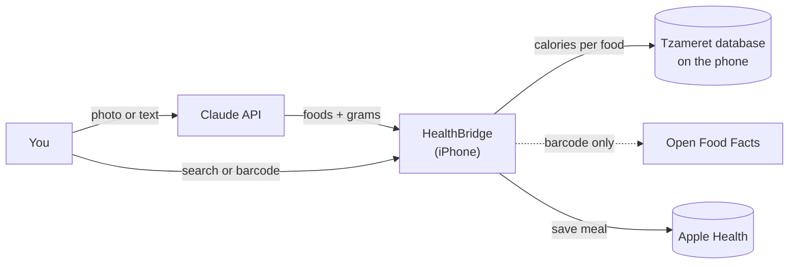

Only a meal photo or description you choose to analyze leaves the phone (to Claude), and
only a scanned barcode number (to Open Food Facts).

- **Google Health API**: `dataPoints` list (newest first, paged), `:reconcile` for sleep,
  `:rollUp` for heart rate (5-minute averages) and hourly steps, `:dailyRollUp` for daily
  totals (steps, floors, total calories).
- **Apple Health**: one writer replaces the sync's own tagged samples per type, so a re-sync
  never duplicates; food entries carry their own ID so they can be deleted individually.
- **Meal analysis**: Claude returns structured JSON (foods, Hebrew search terms, grams);
  the app matches each to Tzameret and computes calories locally.

## Setup

You need a Mac with Xcode, an iPhone, and the Google account your band syncs to.

### 1. Google Cloud (one time, ~10 min)

<details>
<summary><b>Steps</b></summary>

1. [Google Cloud Console](https://console.cloud.google.com/) → create a project.
2. **APIs & Services → Library** → "Google Health API" → **Enable**.
3. **Google Auth Platform → Branding**: app name, support email, developer email, home page
   and privacy policy links (this repo publishes both from `docs/` with GitHub Pages), and
   the authorized domain.
4. **Audience**: user type **External**, add your Google account as a test user, then
   **Publish app**. Publishing without verification is free and keeps the sign-in from
   expiring every 7 days; you'll see a "Google hasn't verified this app" warning when
   signing in (Advanced → continue). Don't submit *data access* for verification: for
   these restricted scopes it requires a paid annual security assessment.
5. **Data Access → Add or remove scopes → Manually add scopes**:
   ```
   https://www.googleapis.com/auth/googlehealth.activity_and_fitness.readonly
   https://www.googleapis.com/auth/googlehealth.health_metrics_and_measurements.readonly
   https://www.googleapis.com/auth/googlehealth.sleep.readonly
   https://www.googleapis.com/auth/googlehealth.nutrition.readonly
   ```
6. **Clients → Create client → iOS**, bundle ID `com.yanivbahalul.stepsbridge`. iOS clients
   have no secret. This project's client ID is already in `Sources/Config/AppConfig.swift`;
   to use your own, see `Sources/Config/Secrets.example.plist`.
7. On the phone, install the **Google Health** app and sign in with the same account once.

</details>

### 2. Build and install

```bash
brew install xcodegen
git clone https://github.com/yanivbahalul/fitness-google-sync.git
cd fitness-google-sync
xcodegen generate
open StepsBridge.xcodeproj
```

1. **Xcode → Settings → Apple Accounts**: add your Apple ID. The development team is set
   in `project.yml` (`DEVELOPMENT_TEAM`); change it to your own team ID if you fork this.
2. Connect the iPhone, pick it as the run destination, press **▶︎**.
3. First run only: enable **Settings → Privacy & Security → Developer Mode** on the iPhone,
   then trust your developer certificate in **Settings → General → VPN & Device Management**.
4. In the app: **Connect Google Health** → allow everything → **Sync Now** → allow Apple Health.

To update later: `git pull && xcodegen generate`, then **▶︎**.

### 3. Optional: meal analysis

Create an API key at [console.anthropic.com](https://console.anthropic.com/settings/keys),
add a few dollars of credit and a spending limit, then paste the key in **Settings → Meal
analysis**. The default model is Claude Opus 5.5 (most accurate, roughly $0.02 per photo);
Sonnet 5.5 and Haiku 5.5 are cheaper. A Claude.ai subscription doesn't cover API use.

## Everyday use

- **Swipe** sideways (or use the switcher) between *Activity* and *Nutrition*.
- Opening the app syncs automatically; the button in the top bar syncs on demand.
- **Google's cloud lags behind the band.** The Google Health app shows new steps right
  away, but they reach the Google Health API only after that app uploads them (minutes,
  sometimes longer). The best moment to sync is just after the Google Health app has synced.
  To do it automatically, in **Shortcuts → Automation → + → App → Google Health → Is Closed →
  Run Immediately**, add **Wait 60 seconds** and **Sync HealthBridge**.
- A lock-screen button: add the *Sync HealthBridge* shortcut as a Control
  (**lock screen → Customize → Controls → Shortcut**).
- **Weekly**: with a free Apple ID the build stops opening after 7 days. You get a
  notification the day before; connect the iPhone and press **▶︎** in Xcode. Data and the
  Google sign-in are kept. (A paid Apple Developer account extends this to a year.)
- **Apple Health source order**: if the iPhone also counts steps, put HealthBridge first in
  **Health → Steps → Data Sources & Access → Edit**.

## Project layout

```
Sources/
├── App/      StepsBridgeApp (entry, auto sync), AppState (shared objects, background task),
│             DesignSystem (colors, spacing, shared components, chart axis),
│             ContentView (pages, sync button, calorie card), ActivityView (activity page),
│             NutritionView (nutrition page, charts), FoodEntryViews (photo/text/search/barcode/review),
│             SettingsView (settings, what to sync, history, steps check)
├── Auth/     GoogleAuthManager (OAuth + PKCE), KeychainStore
├── Config/   AppConfig (OAuth client), Secrets.example.plist (optional override)
├── Food/     FoodDatabase + tzameret.json, FoodLog (diary ↔ Apple Health),
│             MealAnalyzer (Claude + Open Food Facts), ProgressModel (charts data)
├── Health/   GoogleHealthClient (API calls), HealthKitWriter (replace-in-window writes,
│             one shared Apple Health permission request)
└── Sync/     SyncCatalog (Google → HealthKit mapping), SyncCoordinator, SyncIntent (Siri/Shortcuts),
              SyncHistory, Notifier
docs/         GitHub Pages: home page, privacy policy, Search Console verification
```

A GitHub Actions workflow compiles the app on macOS for every push (unsigned).

## Privacy

Health data goes from Google Health directly to Apple Health on the phone; there is no server.
The Google token and the Claude API key are stored only in the iPhone Keychain. Only a meal
photo or description you choose to analyze is sent to Anthropic's Claude API, and only a
scanned barcode number is sent to Open Food Facts. See the
[privacy policy](https://yanivbahalul.github.io/fitness-google-sync/privacy.html).

## Limitations

- **Background sync is best-effort.** iOS decides if and when it runs; the Shortcuts
  automation is the reliable daily option.
- **HRV** is only written when Google provides an SDNN value (Apple Health's format); Google
  usually reports RMSSD, so it's off by default.
- **Burned calories** depend on Google's estimate from the band.
- **Photo portions are estimates** (typically ±20–30%); review them before saving.
- The Google Health API is new; if a data type starts failing, check the
  [data types reference](https://developers.google.com/health/data-types).

## Troubleshooting

<details>
<summary><b>"Signing requires a development team"</b></summary>

Set your team in **Signing & Capabilities**, or put your team ID in `project.yml` under
`DEVELOPMENT_TEAM` so `xcodegen generate` keeps it. Find it with
`security find-certificate -c "Apple Development" -p | openssl x509 -noout -subject` (the `OU=` value).
</details>

<details>
<summary><b>"Developer Mode disabled" / "Untrusted Developer"</b></summary>

Developer Mode appears under Privacy & Security only after Xcode tries to run on the phone.
Then trust the certificate under General → VPN & Device Management.
</details>

<details>
<summary><b>A data type shows ⚠️ after syncing</b></summary>

"No permission": disconnect and connect Google again, allowing every scope. Otherwise open
the sync log (clock icon) to see which types failed.
</details>

<details>
<summary><b>HealthBridge shows fewer steps than the Google Health app</b></summary>

Google's cloud hasn't received the latest data yet; the "band data until" line on the
Activity page shows how far it goes. Open the Google Health app, wait until it finishes
syncing, then sync HealthBridge (or use the automation above).
</details>

<details>
<summary><b>Steps in Apple Health differ from Google</b></summary>

Open **Settings → Steps check**. If HealthBridge matches Google but Apple Health doesn't,
another source (the iPhone) is winning; reorder sources as described above.
</details>

<details>
<summary><b>Meal analysis says the key is invalid or has no credit</b></summary>

Check the key in Settings and the balance at console.anthropic.com.
</details>

## Data sources

- Food nutrients: **Israeli National Nutrition Database (Tzameret)**, Ministry of Health,
  via [data.gov.il](https://data.gov.il/dataset/nutrition-database).
- Packaged foods: [Open Food Facts](https://world.openfoodfacts.org/) (ODbL).
- Health data: [Google Health API](https://developers.google.com/health).
